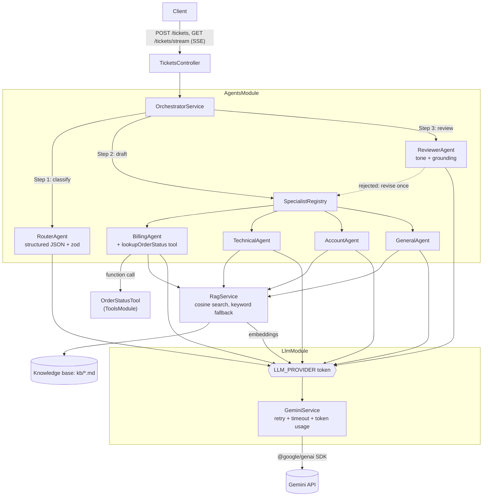

# Support Triage: a multi-agent backend in NestJS with Gemini

A **learning-quality** multi-agent system for triaging customer support tickets, built with **NestJS + TypeScript** and the **free Google Gemini API** (`@google/genai`, flash model).

Read the code alongside the **Concepts & interview questions** section at the end. Every file has comments explaining *why* it's written the way it is, not just *what* it does.

```
POST /tickets  ->  Router agent  ->  Specialist agent (RAG + tools)  ->  Reviewer agent  ->  (1 revision?)  ->  reply
```

## Architecture



**Pipeline per ticket**

1. **Router**: classifies `category` (billing / technical / account / general), `priority`, `sentiment`, `confidence`, and `summary`. The output is JSON that matches a zod schema. If the JSON is invalid, the router gets one self-repair attempt and then falls back to a safe default.
2. **Specialist**: picked by category. It retrieves the top-k KB chunks (Gemini embeddings + in-memory cosine similarity, falling back to keyword search) and drafts a reply with citations like `[billing.md#double-charges]`. The **billing** specialist can also call the `lookupOrderStatus` tool in an agent loop.
3. **Reviewer (critic)**: checks tone (1–5), grounding against the same evidence the writer had, and safety. Approval is enforced in code as `approved && grounded && tone >= 4`. If the draft is rejected, the specialist revises it **once**. If it's still rejected, the result sets `needsHumanReview: true`.
4. **Orchestrator**: runs the steps in order, records a trace with timings, tracks token usage per request, and streams events over SSE.

## Project structure

```
src/
  main.ts                    bootstrap, graceful shutdown
  app.module.ts              root module, ConfigModule.forRoot (validated env)
  app.setup.ts               global ValidationPipe + exception filter (shared with e2e tests)
  config/                    zod env validation + typed AppConfig
  llm/                       LlmProvider interface + LLM_PROVIDER token, GeminiService adapter,
                             retry/backoff/timeout utils, TokenUsageService, error types
  agents/
    base.agent.ts            call / callStructured (validate + repair) / runToolLoop (agent loop)
    schemas.ts               zod schemas -> TS types + JSON Schema for the model
    router.agent.ts          classification agent
    reviewer.agent.ts        critic agent
    orchestrator.service.ts  the pipeline
    specialists/             abstract SpecialistAgent + billing/technical/account/general + registry
  rag/                       chunking, cosine similarity, keyword scoring, RagService (index at boot)
  tools/                     AgentTool interface + mock OrderStatusTool (zod-validated args)
  tickets/                   TicketsController (POST /tickets, GET /tickets/stream SSE), HealthController
  dto/                       CreateTicketDto (class-validator), response type
  common/                    LlmExceptionFilter (503 / 429 / 504 / 502 mapping)
  testing/                   MockLlmProvider, test module builder, jest setup
kb/                          knowledge base markdown (one "## section" = one chunk)
```

## Run it

Requirements: Node 20+ and a free Gemini API key from <https://aistudio.google.com/apikey>.

```bash
npm install
cp .env.example .env          # put your key in GEMINI_API_KEY
npm run start:dev             # watch mode, http://localhost:3000
# or: npm run build && npm run start:prod
```

The app **boots without a key**. In that case `/health` works, RAG uses keyword search, and `POST /tickets` returns `503` with a clear message.

```bash
curl localhost:3000/health

curl -X POST localhost:3000/tickets -H 'content-type: application/json' -d '{
  "subject": "Charged twice!",
  "body": "I was charged two times for my order ORD-1002. Fix this now.",
  "orderId": "ORD-1002"
}'

# Live progress via Server-Sent Events
curl -N "localhost:3000/tickets/stream?subject=App%20crash&body=The%20app%20crashes%20when%20I%20upload%20a%20PDF"
```

Mock orders available to the tool: `ORD-1001` (delivered), `ORD-1002` (charged twice, refund pending), `ORD-1003` (shipped).

**Docker**

```bash
docker build -t support-triage .
docker run -p 3000:3000 --env-file .env support-triage
```

**Tests** (no network and no API key needed; the LLM is mocked through DI)

```bash
npm test
npm run test:cov
```

**Free tier tips:** each ticket makes about 3–5 model calls (router, specialist plus any tool round trips, reviewer, and possibly a revision with a second review). At boot there's one batched embedding call. If you hit 429s, the service retries with exponential backoff. You can also set `RAG_USE_EMBEDDINGS=false` to save quota while you're developing.

---

## Concepts & interview questions

### Where each concept lives

| Concept | File(s) |
|---|---|
| **Agent loop / ReAct** (model decides, acts, observes) | `agents/base.agent.ts` → `runToolLoop` |
| **Tool / function calling** | `tools/order-status.tool.ts`, `agents/specialists/billing.agent.ts`, `llm/gemini.service.ts` (functionDeclarations) |
| **Structured output** (JSON schema + validation + repair) | `agents/schemas.ts`, `base.agent.ts` → `callStructured`, `router.agent.ts` |
| **RAG** (chunk → embed → retrieve → ground) | `rag/text-utils.ts`, `rag/rag.service.ts`, `specialist.agent.ts` → `buildUserPrompt` |
| **Graceful degradation** (keyword fallback, safe default classification, fail-closed review) | `rag.service.ts`, `router.agent.ts`, `reviewer.agent.ts` |
| **Multi-agent patterns**: router, sequential pipeline, generator/critic (reflection), human in the loop | `orchestrator.service.ts`, `reviewer.agent.ts`, `specialist.registry.ts` |
| **Prompt engineering**: roles, few-shot, delimiters, temperature | `router.agent.ts`, `specialist.agent.ts`, `base.agent.ts` → `formatTicket` |
| **Prompt injection mitigation** | `base.agent.ts` (`UNTRUSTED_INPUT_RULE`), tool arg validation, reviewer, no money-moving tools |
| **NestJS modules, DI, custom providers** (`useExisting`, `useFactory`, Symbol tokens) | `llm/llm.module.ts`, `agents/agents.module.ts`, `app.module.ts` |
| **Config & fail-fast validation** | `config/` |
| **Validation at the boundary, DTOs** | `dto/create-ticket.dto.ts`, `app.setup.ts` |
| **Error mapping / exception filters** | `common/llm-exception.filter.ts` |
| **Resilience**: retry, exponential backoff, jitter, timeouts, abort | `llm/retry.util.ts`, `gemini.service.ts` |
| **Observability**: Logger, trace, token usage | `token-usage.service.ts`, `orchestrator.service.ts`, `/health` |
| **Streaming (SSE)** | `tickets/tickets.controller.ts` |
| **Testing LLM apps** (mock provider, overrideProvider, SDK mock, e2e) | `testing/`, `**/*.spec.ts` |
| **Deployment**: multi-stage Docker, healthcheck, graceful shutdown | `Dockerfile`, `main.ts` |

### Suggested study order

1. `llm/llm.types.ts` → `gemini.service.ts`: how one model call works (messages, system prompt, temperature, usage).
2. `agents/schemas.ts` → `router.agent.ts`: structured output.
3. `rag/`: embeddings, cosine similarity, chunking.
4. `tools/` → `base.agent.ts` (`runToolLoop`) → `billing.agent.ts`: function calling and the agent loop.
5. `reviewer.agent.ts` → `orchestrator.service.ts`: multi-agent orchestration.
6. `llm/retry.util.ts`, `common/`, `tickets/`: production concerns.
7. `*.spec.ts`: how to test all of the above deterministically.

### Likely interview questions (with short answers)

**LLM & agent fundamentals**

- **Q: What's the difference between a chain, a workflow, and an agent?**
  A chain or workflow follows control flow that *you* wrote. An agent lets the *model* choose the next action (which tool to call, or whether to answer) inside a loop. This project is a workflow whose steps are agentic: the pipeline is deterministic, and the specialist runs a tool loop. That's usually more reliable and cheaper than one fully autonomous agent.
- **Q: How does function calling actually work?**
  You send tool *declarations* (name, description, and a JSON Schema for the arguments). The model returns a `functionCall` with arguments instead of text. *Your code* runs the function and sends a `functionResponse` back, and the model continues from there. The model never executes anything itself. See `runToolLoop`.
- **Q: How do you stop an agent from looping forever?**
  Cap the number of steps (`AGENT_MAX_TOOL_STEPS`), withhold tools on the last step so the model has to answer, set timeouts per call, and cap the number of revisions (`MAX_REVISIONS = 1`). Production systems also add a token or cost budget per request.
- **Q: Temperature: what value do you use where?**
  Use about 0 for classification and review, where you want repeatable answers. Use about 0.3–0.5 for writing replies, where you want natural language without making things up.

**Structured output**

- **Q: How do you get reliable JSON out of an LLM?**
  Use the provider's JSON mode with a schema (`responseJsonSchema`), validate the result at runtime with zod, send the validation errors back to the model for one repair attempt, and fall back to a safe default if that still fails. Never `JSON.parse` the output and trust it blindly.
- **Q: Why validate when the provider already enforces a schema?**
  Output can still be truncated or semantically wrong (a valid enum value but the wrong category), constraint support differs between providers and models, and validation keeps you portable.

**RAG**

- **Q: Explain RAG end to end.**
  Offline: split documents into chunks, embed each chunk, and store the vectors. Per query: embed the question, find the nearest chunks by cosine similarity, and put them in the prompt with instructions to answer *only* from that context and to cite sources.
- **Q: Why chunk documents? How do you choose a chunk size?**
  Precision and token budget. Large chunks blur meaning and waste context, and tiny chunks lose context. Split on semantic boundaries such as headings, or use roughly 300–800 tokens with some overlap, then tune against an eval set.
- **Q: When does in-memory search stop being enough?**
  Brute-force cosine is O(N·d). Somewhere past roughly 100k chunks, or when you run several replicas that need a shared index, move to a vector DB (pgvector, Qdrant, Pinecone) with approximate nearest neighbour indexes (HNSW).
- **Q: How do you reduce hallucinations?**
  Ground answers with RAG, instruct the model to say "I don't know" or escalate, require citations, add a critic or reviewer that checks grounding against the same evidence, use low temperature for factual steps, and keep a human in the loop for low-confidence or rejected answers.
- **Q: What's hybrid search?**
  Combining keyword search (BM25) with vector search and merging the results (for example with reciprocal rank fusion). Keyword search catches exact IDs and error codes, and vectors catch paraphrases. This repo uses keyword search only as a fallback, which is a natural next step to extend.

**Multi-agent design**

- **Q: Why several agents instead of one big prompt?**
  Each agent gets a focused prompt and toolset, which gives better quality and fewer tokens. You can test agents individually, use a cheaper model for routing, and assign tools on least privilege (only the billing agent can look up orders).
- **Q: Which patterns do you know?**
  Router/dispatcher, sequential pipeline, orchestrator–workers (fan-out and fan-in), generator–critic (reflection), supervisor/hierarchical, debate, and human in the loop. This repo uses router, pipeline, critic, and human in the loop.
- **Q: How do agents share state?**
  Through explicit typed objects (`Draft`, `Classification`, `AgentContext`) passed by the orchestrator. Frameworks like LangGraph formalise this as a state graph with checkpoints.
- **Q: How do you debug a multi-agent run?**
  Keep a per-request trace of every step's input, output, latency, and tokens (`trace` in the response, SSE events), use correlation IDs (`ticketId`), and export traces to Langfuse, LangSmith, or OpenTelemetry. Replay failing cases in tests with a mocked LLM.

**NestJS**

- **Q: Why inject `LLM_PROVIDER` instead of `GeminiService`?**
  Dependency inversion. Agents depend on an interface, so tests use `overrideProvider(LLM_PROVIDER)` and switching providers means writing one new adapter. A Symbol token is needed because TypeScript interfaces don't exist at runtime.
- **Q: `useClass` vs `useValue` vs `useFactory` vs `useExisting`?**
  `useClass` creates a new instance of a class. `useValue` provides a constant or mock. `useFactory` computes the value and can be async with injected dependencies (see `SPECIALIST_AGENTS`). `useExisting` aliases an existing provider (see `LLM_PROVIDER → GeminiService`).
- **Q: What are provider scopes? Why not request-scoped agents?**
  The default scope is a singleton. `REQUEST` scope creates a new instance per request and bubbles up the dependency chain, which costs performance. Here a small context object is passed explicitly instead.
- **Q: Where do validation and error mapping happen?**
  The global `ValidationPipe` uses class-validator DTOs and returns 400. Exception filters map domain errors to HTTP status codes (503, 429, 504), so services stay HTTP-agnostic.
- **Q: What lifecycle hooks are used?**
  `OnApplicationBootstrap` builds the RAG index, and `enableShutdownHooks()` gives graceful shutdown on SIGTERM.

**Production concerns**

- **Q: How do you handle rate limits (HTTP 429)?**
  Retry only retryable errors (429, 5xx, timeouts) with exponential backoff, jitter, and a cap. Return 429 with `Retry-After` to clients when retries run out. At scale, add a queue (BullMQ) with a concurrency limit, a client-side token bucket, and caching.
- **Q: How do you keep costs down?**
  Track tokens per agent (`/health`), keep prompts short, use flash or lite models for routing, cap loops and revisions, cache embeddings and repeated answers, limit input size (DTO `MaxLength`), and batch embedding calls.
- **Q: How do you defend against prompt injection?**
  Treat user text and tool arguments as untrusted, wrap user text in delimiters, validate tool arguments with zod, grant least-privilege tools (no refund tool here), require human approval for side effects, and use an output reviewer. No single defence is enough.
- **Q: How would you scale this?**
  The service is stateless apart from the in-memory index, so you can scale horizontally behind a load balancer. Move the index to a vector DB, process tickets asynchronously through a queue, and put a global rate limiter in front of the LLM.

**Testing & evaluation**

- **Q: How do you unit test LLM code?**
  Mock the provider (see `MockLlmProvider`) and script its responses to test *your* logic: routing, repair, tool loops, revision limits, and fallbacks. Mock the SDK to test the adapter mapping (`gemini.service.spec.ts`). Use supertest e2e tests for HTTP behaviour.
- **Q: How do you test *quality*?**
  With evals: a golden dataset of tickets with expected categories (measure accuracy and a confusion matrix), LLM-as-judge rubrics for reply quality, retrieval metrics (recall@k), and regression runs in CI whenever prompts or models change.

## Ideas to extend (good practice tasks)

- Add an eval script that runs 20 labelled tickets and reports router accuracy.
- Replace the in-memory index with pgvector, and add hybrid search with reciprocal rank fusion.
- Run the specialist and a "policy checker" agent in parallel (fan-out/fan-in).
- Stream tokens from the specialist (`generateContentStream`) over SSE.
- Persist tickets and traces in Postgres; add a BullMQ queue for async processing.
- Port the orchestrator to LangGraph.js and compare.
